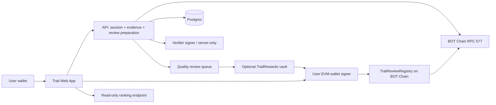

# TRAIL — V2 Five-Hour Backend-First Execution Plan

**Date:** November 10, 2026 (WAT / Lagos)  
**Repository:** https://github.com/Devendurance/trail  
**Source of truth:** This V2 plan **supersedes the earlier TRIED/Trail documents where they conflict**, especially earlier prohibitions on compensated reviews. Rewards are now allowed only under the quality-first, sentiment-neutral, transparent policy in `QUALITY_REWARDS_POLICY.md`.  
**Deadline:** Five focused hours from agent start, with a mainnet launch target of November 13. Five hours is an engineering timebox, not permission to skip critical verification or contract-security gates.

## 0. Product promise and non-negotiable separation

Trail lets people discover BOT Chain DApps, read **firsthand, evidence-backed experiences**, and publish honest reviews after proving a supported mainnet action. Community ratings and rankings are based on eligible review outcomes, not paid popularity votes. High-quality reviews may earn a **separately funded BOT thank-you reward**, regardless of positive or negative sentiment.

**Trail is not:** a scam-certification service, financial advisor, generic quest platform, on-chain popularity-vote leaderboard, pay-for-positive-reviews market or sybil-proof identity protocol. A successful supported transaction demonstrates one eligible on-chain action; it **does not** prove the entire product worked, that the reviewer is unique, or that their words are accurate.

### Exactly what “functional MVP” means

- A working curated app directory with one thoroughly verified supported action, ideally two.
- A visitor can read genuine app details/reviews without connecting a wallet.
- A real user can sign in with their EVM wallet, provide a prior valid mainnet transaction hash, and see evidence validated by a strict verifier.
- They can submit a truthful 1–5 experience score, plain-text written review and optional friction category, then publish a **real Trail on-chain review transaction** via an EIP-712-authorized registry.
- The public app page shows the review and **two explorer links**: (a) underlying real product-action tx, (b) Trail review-publication tx.
- A transparent rank/discovery screen calculates statistics only from eligible reviews, showing sample size and an “early feedback” state when low-sample.
- Reward quality assessment and reward eligibility exist from day one; **live BOT reward payout is enabled only once a funded, independently tested rewards vault has been deployed**. Otherwise label it “Coming soon / not yet funded,” not “Earn BOT now.”

## 1. Prioritize the dependency that can kill the project

**First 20 minutes must validate one real external action.** Do not spend 2 hours designing a directory only to discover that no real transaction can be verified.

Candidate A — **BOT Names** (public documentation: https://botn.in/docs):
- Official DomainNFT contract: `0xBeB7B2BD305F0d9412EB1f4C49541FD048C363CE` on chain 677.
- Documented `mintDomain(string)` function and ERC-721 mint `Transfer(address(0), wallet, tokenId)` pattern (VERIFY current live ABI and actual transaction before enabling).
- A valid user might already hold a historical successful mint transaction. Review it without forcing a fresh paid mint.

Candidate B — **BDEX V2** (https://dev-docs.botchain.ai/docs/DEX/contract-addresses/):
- Official mainnet V2 Router02: `0x1414eD29FdFD322c3c0a830330ed982E2D629e76`.
- Official universal router: `0xaE6ae8630f7A888dEc0B9195C85F7515d5887655`.
- Swaps can be nested via routers/pools. DO NOT accept generic swap logs without tying caller, approved router, exact action selector and valid pool/event relationship. Use only a verified narrow route or choose another simpler real DApp.

**Evidence gate:** Record a known-real receipt hash, chain ID, `tx.from`, `tx.to`, selector, receipt `status`, event emitting address and decoded event fields, block, required confirmations, and tested false positives. If a candidate has no clear real sample, mark it **unsupported**, not verified. One complete integration is better than two fakes. Two genuinely supported apps remain the target for useful rankings.

## 2. Architecture and trust boundaries (backend first)



**Security invariants:** The server **verifies** past receipts, but cannot publish a review for another user's wallet. Only the wallet can call `publishReview` and `msg.sender` must match signed reviewer. No reviewer private keys or seed phrases collected. Off-chain text is hash-committed on-chain. Quality approval must not alter ratings or app rankings.

### Stack

- **Next.js** App Router + strict TypeScript + Tailwind and React.
- **wagmi + viem** for EVM wallets, contract writes, receipt/log reads; `zod` for typed input validation.
- **Solidity** with Foundry and pinned OpenZeppelin 5.x EIP-712 / ECDSA access control and test helpers.
- **Postgres** (existing connected Neon or Supabase, if available; else a fresh provisioned DB) with migrations. Never use local-only SQLite for production deployment unless persistence is guaranteed.
- **Vercel** or equivalent deployment; API route or server runtime with secret-backed verifier key, DB and chain RPC.
- Environment split: BOT mainnet `677`, `https://rpc.botchain.ai`, `https://scan.botchain.ai`; Bohr testnet `968`, `https://rpc.bohr.life`, `https://scan.bohr.life`.
- Do not hard-code an unverified contract address, use mixed test/mainnet addresses, or expose signer/deployer keys to browser.

## 3. Backend: contract FIRST, then evidence + database + APIs

### Contract: `TrailReviewRegistry.sol`

Minimal interface (exact design can be improved by implementation agent, preserving guarantees):

```solidity
enum Outcome { WorkedWell, WorkedWithFriction }
struct ReviewAuth {
  address reviewer;
  uint256 projectId;
  bytes32 proofTxHash;
  bytes32 contentHash;
  uint8 rating;       // 1..5, user-reported
  Outcome outcome;    // user-reported
  uint256 nonce;
  uint64 deadline;
}
function publishReview(ReviewAuth calldata auth, bytes calldata sig) external;
function hasReviewed(uint256 projectId, address reviewer) external view returns (bool);
function getReviewer(uint256 reviewId) external view returns (address);
event ReviewPublished(uint256 indexed reviewId, uint256 indexed projectId,
  address indexed reviewer, bytes32 proofTxHash, bytes32 contentHash,
  uint8 rating, Outcome outcome);
```

**Must check on-chain:** caller == reviewer; signer == authorized verifier; EIP-712 domain `name/version/chainId/verifyingContract`; deadline; nonce; 1–5 rating; active project ID; nonzero proof/content hashes; one review per wallet/app; globally unique `(chainId, proofTxHash)` use; replay-safe events. Admin can rotate signer / pause new reviews, but **cannot edit existing reviews or rate scores**. Avoid upgradeable proxies and contracts with custody in the review registry.

**Tests:** invalid signature/chain/contract, expired, wrong caller, repeat nonce, proof replay across projects, second review per wallet/app, score 0 or 6, invalid project, signer rotation, pause and normal publication. Passing a compile-only smoke test does not count as complete.

### Authentication and backend

- **Wallet challenge/session:** 10-minute expiring single-use nonce, bound to domain, wallet and chain; user signs a readable message; server verifies and returns `HttpOnly`, `Secure`, `SameSite=Lax` session. Session does **not** publish an on-chain tx.
- **Project registry:** curated canonical app URLs and code/verified contract references. App listing state = `draft | supported | disabled`; supported actions are **versioned**.
- **Evidence:** `GET transaction + receipt` from chain-677 RPC; require included successful receipt, `tx.from == connected wallet` (EOA-only V1), expected `tx.to`, allowed 4-byte selector, expected event emitter and event/topic & decoded wallet/value checks, block after deployment, small confirmation threshold, and unused proof. No generic `Transfer`, ordinary token transfer or wallet connection qualifies by itself.
- **Review preparation:** normalize plain-text body (recommended 100–700 characters), verify rating 1–5, outcome, hash normalized content, enforce author/app/proof uniqueness, issue EIP-712 signed authorization (e.g. 10 minutes). The client sends this in a wallet transaction. Store staged draft, not a fabricated confirmed review.
- **Index/reconcile:** only mark published when a successful receipt with `ReviewPublished` from **the exact registry address** is observed. Reconcile failed or interrupted submissions by event index; no duplicate records.
- **Discovery/rank:** read published reviews, dedupe to one wallet/app; calculate per-app count and honest user score; no “best” badge below threshold.
- **Quality/moderation:** queue, outcome-independent review rubric, admin approval and reward budget states. The review's `rating` and `outcome` are **NOT** review-quality grades.

### Database tables (minimum viable)

```text
projects(id, slug UNIQUE, name, official_url, category, description, status, created_at)
supported_actions(id, project_id FK, version, chain_id, approved_target,
                  function_selector, event_emitter, event_topic0,
                  min_block, eligible_wallet_rule, sample_tx_hash, enabled)
login_nonces(nonce_hash PK, wallet, chain_id, domain, expires_at, used_at)
reviews(id, onchain_review_id UNIQUE nullable, project_id, reviewer,
        proof_tx_hash UNIQUE, review_tx_hash UNIQUE nullable, rating,
        outcome, normalized_body, content_hash, status, created_at)
quality_assessments(review_id UNIQUE, completeness, specificity, usefulness,
                    originality, moderation_status, reviewer_notes, assessed_at)
reward_allocations(review_id UNIQUE, claimant, amount_wei, status,
                   approved_at, chain_tx_hash nullable)
verification_attempts(id, wallet, project_id, tx_hash, result_code, created_at)
```

DB constraints + contract checks both matter. A pending/expired draft can be retried; a confirmed published review cannot be silently overwritten. No fake test reviews on public mainnet pages.

### REST API contract

| Route | Method | Behavior / security |
| --- | --- | --- |
| `/api/health` | GET | Check API health and deployed config; don't leak secrets. |
| `/api/projects` | GET | Published supported apps plus review counts and proof-coverage labels. |
| `/api/projects/:slug` | GET | Verified listing and reviews; avoid unapproved outbound URLs. |
| `/api/auth/challenge` | POST | Domain-bound nonce and 10-min expiry; rate limit. |
| `/api/auth/verify` | POST | Verify signed challenge; invalidate nonce; secure session cookie. |
| `/api/proofs/verify` | POST | Apply full project-specific adapter to a chain-677 receipt. |
| `/api/reviews/prepare` | POST | Validate proof+content, reserve draft, sign EIP-712 review auth. |
| `/api/reviews/reconcile` | POST | Check actual on-chain publication receipt and event. |
| `/api/reviews/:id` | GET | Review text/hash, public proof and publication links. |
| `/api/rankings` | GET | Reproducible sample-size-aware ranking, read-only. |
| `/api/admin/review-quality` | POST | Authenticated admin assessment, audit logged; no public privilege. |
| `/api/rewards/:reviewId` | GET | Eligible/pending/approved/claimable/paid, without misleading guarantee. |

**Response error codes:** `WRONG_CHAIN`, `WRONG_WALLET`, `TX_NOT_FOUND`, `TX_FAILED`, `INSUFFICIENT_CONFIRMATIONS`, `UNSUPPORTED_ACTION`, `PROOF_ALREADY_USED`, `REVIEW_ALREADY_EXISTS`, `INVALID_RATING`, `VERIFIER_UNAVAILABLE`, `REGISTRY_PAUSED`. These must appear in test coverage and as comprehensible UI messages.

## 4. Rankings that are actually trustworthy

**Never rank by reward payout**, vote count, transaction volume or favorable reviews alone. Use only valid published reviews.

For each app, calculate:

- `n`: number of different eligible reviewer wallets (one review per wallet/app).
- `avg`: arithmetic mean of self-reported 1–5 ratings.
- Bayesian-smoothed score: `(n*avg + 5*3.0)/(n+5)` for a neutral prior of 3/5 with strength 5. Display the exact methodology, review count and a disclaimer.
- **Ranking threshold:** if `n < 3`, show *Early feedback — insufficient reviews to rank*. With `n >= 3`, show *Community experience rank (early sample)*; avoid claiming a security or definitive best-DApp ranking.
- Use tie-breakers of review count and recency, published and deterministic. Treat reward status and assessor score as **excluded** from this formula.

Successful-only proof creates survivorship bias. The page must state that V1 verification is limited to successful supported actions; a DApp that consistently fails *before success* will be underrepresented. Add a separate clearly marked unverified issue-report channel later, not a false verified review today.

## 5. Cashback/quality rewards: implementable version

**A. Reward status and quality review:** Ship alongside backend, even if BOT payouts are not yet enabled. `none → submitted → under_quality_review → approved_unfunded | claimable | rejected → claimed`. Display no numeric guaranteed payout if pool isn't funded.

**B. Quality rubric:** 0–10 points (specific action/context 0–2; clear outcome 0–2; helpful explanation 0–2; originality 0–2; actionable feedback 0–2); verified-use eligibility is mandatory. At **7+**, an independent moderator may approve, regardless of positive or negative rating. Exclude copy-paste, coordinated fake usage, undisclosed conflicts and duplicate claims. Keep human override/reasons/appeal log.

**C. BOT reward vault (funded only after tests):** A **separate** `TrailRewards` contract, never mixed into registry. After a review is published and adjudicated, an admin can approve a fixed `amountWei` for a real `reviewId` subject to funded balance and per-review cap. The vault asks the registry for `getReviewer(reviewId)` and binds the allocation to that wallet. Only the reviewer can `claimReward(reviewId)`; state updates before BOT transfer, `nonReentrant`, double-claim impossible, pause/allowance cap. The claimant needs BOT gas. `claimReward` is a separate product benefit; **do not count it as a verified review or rely on it for Mary's core interaction minimum**.

**D. Budget and ethics:** Owner deposits a small explicitly chosen BOT budget first. Per-review amount, cap per wallet/month, funding source and eligibility policy published. Do not pay for a positive rating or condition money on changing a review. BOT paid is a review-quality thank-you, not an ecosystem rebate, and not guaranteed before approval/funding.

**Gate:** If the rewards vault lacks tests, funding or review-side moderation, it remains disabled with an honest explanation and TODO, while the real Trail review product is allowed to launch. Do NOT deploy an untested financial escrow for the sake of the five-hour timebox.

## 6. Frontend: only after backend and contract gates pass

**Pages:**

- `/` — Trail identity, one-sentence promise, real DApp discovery.
- `/discover` — category filter, verified-review counts, transparent early ranking.
- `/apps/[slug]` — official link, supported action, reviews, average rating, sample count, clear evidence limitations.
- `/review/[slug]` — wallet connect, evidence tx, proof result, rating (1–5), outcome, 100–700-char written review, preview, wallet publication and confirmed receipt.
- `/reviews/[id]` — stable, shareable individual review showing **underlying DApp tx and Trail publication tx**.
- `/rewards` — quality policy and funded/program state; claim if/when vault live.
- `/methodology` — exactly what proof/quality/ranking does and does not mean.

**UX:** Don't gate browsing on wallet connection. Avoid claiming gasless review publication. Implement loading, rejected signature, wrong network, insufficient BOT, pending tx, reverted receipt, unavailable RPC and review quality status as explicit states. Site footer must show BOT Chain name/logo and two official links. Mobile-first, keyboard accessible and no fabricated testimonies or mock ratings visible in production.

## 7. Five-hour clock — hard gates, backend first

| Elapsed | Work | Mandatory checkpoint |
| --- | --- | --- |
| **0:00–0:20** | Clone empty repo; verify tools/config; identify one actual eligible third-party mainnet receipt and action rule; create state tracker | One real fixture or documented blocker. No UI work. |
| **0:20–1:10** | Next.js/Foundry scaffold, registry contract + negative tests, versioned supported-action config | Registry tests pass. |
| **1:10–2:10** | Postgres migrations, wallet nonce auth, receipt verifier adapter + fixtures, signed prepare endpoint | Positive and negative proof tests pass end to end. |
| **2:10–2:55** | Review reconciliation, public data queries, ranking aggregation, quality-review states and admin access | One complete backend review lifecycle in tests. |
| **2:55–3:50** | Functional frontend wired to REAL APIs/contracts: discovery → proof → review → receipt | No hardcoded fake data; full user flow visible. |
| **3:50–4:30** | Testnet E2E → mainnet deploy/verify (only if tests pass), validate funded gas; responsive QA | Real successful mainnet review publication or a documented deployment blocker. |
| **4:30–5:00** | Production deployment, smoke tests, source/contract verification, evidence sheet, mainnet announcement if genuinely live | Public site, proof links, tests, known gaps, no false claims. |

**Reward contract attempt:** If the core product is fully green **before** 3:50, spend spare capacity on fully testing/funding `TrailRewards`; otherwise quality policy/status and reward architecture remain implemented/documented with payout disabled. Do not steal time from proof verification or launch safety gates.

## 8. Detailed verification and security gates

- `npm run typecheck`, lint, build; Foundry compile + contract unit tests + negative tests.
- Server unit tests use *real recorded* fixtures for eligible and ineligible receipts; chain 677, target/selector/logs, wallet and confirmation checks.
- DB unique proof and wallet/app indexes, idempotent publish reconciliation, transactions rolled back on failure.
- EIP-712 tests: forged server signature, wrong wallet, wrong chain, wrong registry, expired auth, duplicate proof, duplicate reviewer/app.
- Browser wallet: wrong chain, rejected signature, insufficient BOT, pending/revert, mobile flow, public pages load without wallet.
- Confirm on-chain ABI/source, contract bytecode, address and explorer receipt links; ensure `ReviewPublished` emitted by real Trail contract.
- Security: rate-limit API; validate `zod`; escape review body; don't log secrets; keep server-only signer; no unapproved official badge.
- Rewards tests when enabled: unfunded, over cap, double claim, wrong recipient, admin spoof, bad registry reference, reverting recipient, reentrancy, paused state.
- No existing real reviews? Show an honest empty state. No fake review/rank cards to impress Mary.

## 9. Mary's seven criteria operationalized

1. **Own X:** at least five substantive posts within the previous 30 days, not recycled from Quilt/Wink.
2. **Launch announcement:** after actual go-live, expressly say Trail has officially launched on BOT Chain **mainnet**.
3. **Website:** reachable live DApp with BOT Chain brand/name and footer links `https://botchain.ai` and `https://scan.botchain.ai`.
4. **Real product:** wallet can complete core on-chain review publication from genuine evidence; not a contract-only demo.
5. **Independence:** distinct repo, brand, domain, copy, review contract and backend from Quilt and Wink.
6. **Real usage:** in seven days of true launch, at least **3 distinct genuine wallets and 5 valid real core review-publication interactions**. Reward claims or random BOT transfers are not a substitute. With only one supported app and one review per wallet/app, this likely requires at least five reviewers. Never coordinate fake reviews or wash actions.
7. **Operation:** maintain site, APIs, verifier, RPC monitoring, X/community updates and real support after Nov 13.

**Ask Mary in writing:** whether compensated quality reviews count toward her KPI, whether an on-chain review publication is an accepted core action, whether old legitimate product-use transactions qualify as review evidence, and whether genuine reviewed apps need to be unaffiliated. Rewards must not be deployed as a KPI-manipulation tactic.

## 10. Hard stop vs permissible cuts

**Must not cut:** real action verification, caller-bound EIP-712 signature, replay protection, receipt checks, correct chain, real transaction publishing, clear limitations, tests, contract verification, live mainnet UX before launch claim.  
**May cut:** two-app target down to one verified app (transparent), animated dashboard, infinite sorting/filtering, accounts beyond wallet, advanced admin UI, fully automated AI quality judgments, auto cashout or reward payouts until funded/tested.

If any mandatory gate fails at the five-hour mark, ship a **truthfully labeled tested beta** (or testnet preview), not a fabricated mainnet product. Safety/actual functionality take precedence over the timestamp.

## 11. Repository structure

```text
trail/
  app/
    page.tsx
    discover/page.tsx
    apps/[slug]/page.tsx
    review/[slug]/page.tsx
    reviews/[id]/page.tsx
    rewards/page.tsx
    methodology/page.tsx
    api/{auth,proofs,reviews,projects,rankings,admin,health}/...
  components/{wallet,app-card,review-form,evidence,rank-list,reward-state}/...
  lib/{chain,abi,verify-proofs,auth,eip712,ranking,quality,db}/...
  db/{migrations,seed.ts}
  contracts/src/{TrailReviewRegistry.sol,TrailRewards.sol}
  contracts/test/{TrailReviewRegistry.t.sol,TrailRewards.t.sol}
  contracts/script/Deploy.s.sol
  scripts/{verify-fixture.ts,smoke-mainnet.ts}
  docs/{TRAIL_V2_5H_EXECUTION_PLAN.md,QUALITY_REWARDS_POLICY.md,AGENT_START_PROMPT.md}
  .fast-build/STATE.md
  .env.example
  README.md
```

Use the agent harness's tracked multi-slice workflow for this sprint. Keep a clean commit per vertical slice, preserve truth about tests and status, and never claim a deployed contract exists before verifying the exact chain/tx.

## 12. Final agent evidence report format

```text
Repository/commit:
Live URL:
Mainnet chain/contract address:
Source verification URL:
Supported app(s) and action signatures:
Real sample eligible underlying transaction hash(es):
Real Trail review-publication tx hash(es):
Tests executed/results:
Wallet E2E (verified?):
Review counts (real, not generated):
Rank formula / sample threshold:
Rewards mode: disabled | funded+claimable
Reward vault address/funded balance if live:
Known risks and blockers:
Mary KPI evidence links (not yet eligible if incomplete):
Next slice:
```

---
**Important:** The old Trail PRD prohibited paid reviews outright. This V2 plan replaces that prohibition with a *sentiment-neutral, transparent, quality-gated review reward* that cannot purchase favorable ratings. All prior security rules and evidence requirements remain in effect.
