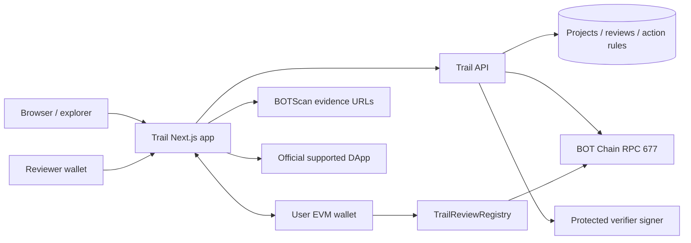
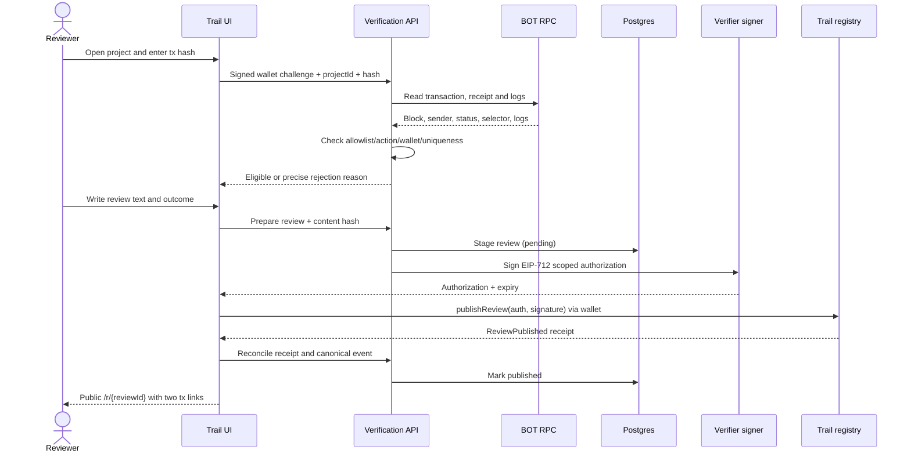

# Trail — System Architecture

**Version:** v1.0 · **Date:** 2026-11-10 · **Style:** curated consumer app + rule-driven server verifier + append-only on-chain review attestation.

## 1. Central architectural principle

Trail is not a generic "paste any tx" verifier. Each supported app has a documented **approved action definition**. The backend checks a successful mainnet transaction against that definition and issues a bounded, wallet-specific authorization. The Trail review registry records the review/proof commitment. The proof is server-verified, not a trustless smart-contract proof of an arbitrary historical event. User-facing labels must preserve that distinction.



## 2. Components / responsibilities

| Component | Operates | Trust boundary |
| --- | --- | --- |
| Curated catalog | Names, official domains, supported action explanations | Curator can approve listings, not fabricate tx receipts |
| Wallet session | Connect and sign challenge to prove wallet control | Challenge signature is not a blockchain action |
| Evidence verification API | Receipt lookup, origin, selector and log policy | Human-managed allowlist; provider may be unavailable |
| Verifier signer | Issue short-lived review authorization after checks | Privileged attester, **not** reviewer or fund custodian |
| Review registry | Enforce reviewer/signature/nonce/proof uniqueness and emit review event | Cannot verify full external receipt itself |
| Postgres | Display names/text, action config, staged review, reconcile status | Not authoritative for on-chain publication |
| Explorer | Independent proof URLs and contract verification | Do not rely on untrusted shortened links |

## 3. Core state and identities

- **Project** is a curator-approved app with canonical domain and stable `projectId`.
- **Supported action** belongs to a project and defines the *exact* target/address/selector/event evidence acceptable in V1, with `minBlock` and version.
- **Reviewer** is an EVM address authenticated by signed challenge, then bound as `msg.sender` of `publishReview`.
- **Proof** is `(chainId=677, externalTxHash)` unique across Trail publication. It proves one eligible tx, not reviewer uniqueness or honest opinion.
- **Review** contains on-chain `(reviewId, projectId, reviewer, proofTxHash, contentHash, outcome)` plus off-chain display text with a verified content hash.

## 4. End-to-end publish flow



## 5. Lifecycle model

```text
Project: DRAFT -> RULE_VALIDATED -> SUPPORTED -> DISABLED
Proof check: UNKNOWN -> VERIFYING -> INELIGIBLE | ELIGIBLE
Review DB: DRAFT -> AUTH_ISSUED -> ONCHAIN_PENDING -> PUBLISHED | EXPIRED_RETRYABLE
Review registry: UNPUBLISHED -> PUBLISHED (append-only)
```

If the user closes the tab mid-publish, scan registry events by `(reviewer, projectId)` and reconcile independently. A failed/reverted `publishReview` must not permanently consume the tx hash in the **database**; only on-chain `proofUsed` means final consumption. Expired signatures can be reissued for the same eligible tx and unchanged authorized wallet if no published review exists, with fresh nonce/deadline and rate limits.

## 6. Integration adapters: narrowly scoped

Build **one verifier adapter per truly supported action**, even when they share generic receipt parsing. Example interface:

```ts
interface ActionVerifier {
  projectId: number;
  version: string;
  verify(input: { wallet: `0x${string}`; txHash: `0x${string}` }): Promise<{
    eligible: boolean;
    reason?: string;
    normalizedAction?: string;
    blockNumber?: bigint;
  }>;
}
```

For V1, `tx.from` must match authenticated wallet; target, selector, contract log and event argument checks are necessary. For BDEX router swaps or smart accounts, custom adapters and tests are required. **Do not label an app supported based only on a name, homepage, or success receipt.** Keep unsupported apps browsable with a clear "review verification not yet available" label, or omit them from the initial launch list.

## 7. Data persistence, privacy and moderation

```text
projects (id, slug, canonical_url, status)
supported_actions (project_id, version, address, selector, event_rule, min_block)
reviews (project_id, reviewer, external_tx_hash, text, content_hash, state, onchain_review_id)
verification_attempts (project_id, result_code, created_at) // short retention
```

Store public reviewer wallet and text only; let users report abusive content. The service may hide hosted text after moderation while the immutable hash/event remains publicly inspectable. Avoid collecting IP-based real-world identities; server security logs should have bounded retention.

## 8. Security/availability boundaries

- Host signer must live server-side, have no custody powers, and be rotated with an audited owner action if compromised.
- On-chain `msg.sender` must equal signed reviewer; project/proof uniqueness and nonces enforced on-chain, not solely DB.
- Review content stored off-chain; hash is included in signed payload, then anchored in registry event.
- Browsing and public old reviews should remain available if verifier API goes down. New reviews may pause rather than bypass checks.
- Monitor chains separately: RPC health, latest block freshness, verifier API, DB, signed-authorizations, successful publication rates.
- User interface should explain that proof eligibility does not equal smart-contract audit, investment endorsement or identity verification.

## 9. Suggested isolated repository

```text
trail/
  app/{page.tsx,apps/page.tsx,apps/[slug]/page.tsx,review/[projectId]/page.tsx,r/[reviewId]/page.tsx,methodology/page.tsx}
  app/api/{auth,projects,proofs,reviews}/...
  components/{app-card,proof-checker,review-composer,verified-review}
  lib/{chain.ts,review-registry.ts,signature.ts,verifiers,db.ts}
  db/{migrations,seed-projects.ts}
  contracts/src/TrailReviewRegistry.sol
  contracts/test/{Signature.t.sol,ReviewRegistry.t.sol}
  contracts/script/Deploy.s.sol
  docs/{PRD.md,TRD.md,architecture.md,projectplan.md}
```

## 10. Architecture acceptance

- [ ] Every public "eligible action verified" badge traces to a validated supported-action rule and actual tx.
- [ ] Unauthorized/failed/unrelated transactions never produce a signer authorization.
- [ ] Registry rejects fake signatures and double-use even if API/DB mistakenly accepts a duplicate.
- [ ] On-chain content hash equals the displayed text hash.
- [ ] Web app can serve existing reviews when signer or DB writes are unavailable (graceful read-only degradation).

**Related:** [`PRD.md`](./PRD.md), [`TRD.md`](./TRD.md), [`projectplan.md`](./projectplan.md).
